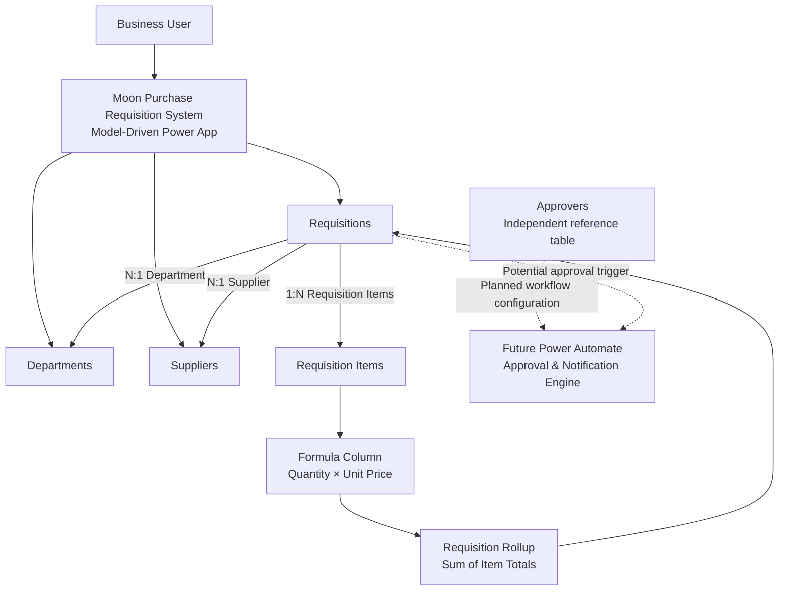

# Moon Purchase Requisition System

### Purchase Request Management, Line-Item Costing & Dataverse-Based Operations | Microsoft Power Platform

Moon Purchase Requisition System is a Microsoft Power Platform solution concept for managing purchase requisitions through a centralized Model-Driven Power App backed by Microsoft Dataverse. It replaces a paper-driven request process with structured department and supplier records, requisition headers, item-level details and calculated purchase values.

The application brings requisition information and its related line items together in one workspace. Dataverse relationships, quick-create forms, formula columns and rollup columns support a streamlined data-entry experience and clearer visibility of request totals.

> **Implementation scope:** The source app covers the Dataverse data model, table configuration, forms, views, calculated fields, rollup configuration, Model-Driven App creation and basic end-to-end testing. A Power Automate approval engine is discussed as a possible next phase, but its flow implementation is not demonstrated in the supplied app transcript. It is therefore documented below as a planned enhancement, not as a completed feature.

---

## App Gallery


| Experience | What it should demonstrate |
|---|---|
| Model-Driven App home | Application navigation and available tables |
| Requisition register | Requisition list, columns, sorting and record access |
| Requisition main form | Request details, department, supplier, priority and justification |
| Requisition line items | Related item subgrid within a requisition |
| Quick-create line item | Inline entry of item name, description, quantity and unit price |
| Department management | Department name, department code and manager email |
| Supplier management | Supplier contact and address information |
| Calculated values | Item total and requisition-level rollup amount |


---

## 01. Project Overview

| Item | Details |
|---|---|
| Application name | Moon Purchase Requisition System |
| Application type | Microsoft Power Apps Model-Driven App |
| Business domain | Procurement / Purchase Request Management |
| Primary purpose | Create and manage purchase requisitions and their line items |
| Data platform | Microsoft Dataverse |
| Workflow platform | Power Automate – planned approval-engine extension |
| Core data entities | Departments, Suppliers, Requisitions, Requisition Items and Approvers |
| User experience | Dataverse model-driven forms, views, subgrids and quick-create forms |
| Project status | Core requisition application demonstrated; approval automation is outside the supplied app scope |

### What the application does

The solution is designed to:

- Maintain department information and manager contact details.
- Maintain supplier information, including contact person, email, phone and address.
- Create purchase requisitions with requester, department, supplier, priority and justification details.
- Associate multiple line items with a single requisition.
- Capture item descriptions, quantities and unit prices.
- Calculate each line item's total using a Dataverse formula column.
- Aggregate line-item totals into a requisition-level amount using a Dataverse rollup column.
- Present related line items directly on the requisition form.
- Use quick-create forms to reduce navigation while entering related records.
- Maintain approver information and approval-level configuration for a potential workflow extension.

### Application modules

| Module / table | Purpose |
|---|---|
| Requisitions | Main workspace for creating and maintaining purchase requests |
| Requisition Items | Child records that capture the products or services requested |
| Departments | Reference data for organizational departments and their managers |
| Suppliers | Supplier master data and contact information |
| Approvers | Approver identity and approval-level reference information |

---

## 02. Business Problem & Objective

### Business problem

A manual purchase requisition process can depend on paper forms, physical hand-offs and individual approvers being available. This can make it difficult for requesters to know where a request stands. Paperwork can be misplaced, and a request may remain pending when an approver is unavailable.

The app describes a small organization seeking a more streamlined way to manage purchase requests and keep track of requisition information.

### Why an application is needed

A centralized requisition application provides structured records for the request, its supplier and department, and the individual items being requested. Keeping the parent requisition and its child line items related in Dataverse makes it easier to review request details and calculate costs.

### Application objectives

1. Centralize purchase requisition records in Dataverse.
2. Maintain reusable department and supplier reference data.
3. Allow one requisition to contain multiple line items.
4. Capture item quantities and unit prices in a consistent structure.
5. Calculate line-item totals automatically.
6. Aggregate item totals into a requisition-level amount.
7. Improve the data-entry experience with main forms, subgrids and quick-create forms.
8. Provide a Model-Driven App interface for accessing and maintaining the records.
9. Establish approver reference information that can support a future approval workflow.

---

## 03. Key Features & Functionality

### 3.1 Department management

The Departments table stores organizational department information used by requisitions.

The demonstrated fields include:

- Department Name – primary name column.
- Department Code – single-line text.
- Manager's Email – email data type.

The department main form is configured to show the relevant business fields. The public view is configured to display the department name, department code and manager email, with records sorted by department name.

A quick-create form is also configured to allow department records to be entered without opening a full record form.

### 3.2 Supplier management

The Suppliers table stores supplier master information.

The demonstrated fields include:

- Supplier Name – primary name column.
- Contact Person – single-line text.
- Contact Email – email data type.
- Contact Phone Number – phone data type.
- Supplier Address – multiple lines of text.

The supplier form and view are configured to expose the supplier information required by the application.

### 3.3 Requisition management

The Requisitions table is the central entity of the application. It stores the overall purchase request and references the relevant department and supplier.

The app identifies fields including:

- Requisition Number – primary name column.
- Title.
- Requester – user column.
- Department – lookup to the Departments table.
- Supplier – lookup to the Suppliers table.
- Priority.
- Justification.
- Total Amount – requisition-level amount, configured as a rollup in the later implementation step.

The main form is arranged to make the request details easy to review. A related-record subgrid is added to the form to display the requisition's line items.

### 3.4 Requisition line items

A requisition can contain multiple line items. For example, a stationery request can include paper, pens and diaries as separate child records under one requisition.

The Requisition Items table captures:

- Requisition – lookup to the parent Requisitions table.
- Item Name – primary name column.
- Description – multiple lines of text.
- Quantity – numeric value.
- Unit Price – decimal value used in the demonstrated formula.
- Total Price – formula column.

This parent-child structure allows users to maintain item-level details without creating a separate requisition for every requested item.

### 3.5 Quick-create experience

Quick-create forms are enabled for the relevant tables to reduce the number of navigation steps during data entry.

The requisition form contains a related line-item subgrid. Users can create a line item from that subgrid using a quick-create form, enter the item details and save without navigating away to a separate full-page form.

The demonstrated line-item quick-create form includes the item name, description, quantity and unit price.

### 3.6 Automatic line-item calculation

The line-item total is calculated using a Dataverse formula column.

**Calculation:**

```text
Total Price = Quantity × Unit Price
```

The app notes a limitation encountered when using currency columns directly in the formula. The demonstrated workaround is to use decimal columns for the unit price and calculated total.

The decimal unit-price field can be presented to the user with a friendly display name, while the calculated total is system-derived and does not need to be manually entered.

### 3.7 Requisition-level rollup

A requisition can contain several line items, so the application also needs to aggregate their calculated totals.

The app configures a Dataverse rollup column on the Requisitions table:

- Column: Total Amount Calculated.
- Data type: Currency.
- Behavior: Rollup.
- Related table: Requisition Items.
- Aggregation: Sum of the child line-item total-price values.

The rollup brings the combined value of the related line items onto the parent requisition record. The app demonstrates manually triggering **Recalculate** from the rollup column during testing.

> Dataverse rollup calculations are system-managed and may not update immediately after every child-record change. Validate the recalculation behavior and timing in the target environment.

### 3.8 Approver reference data

The Approvers table is introduced to store information that can be used by a future approval-notification engine.

The demonstrated design includes:

- Approver name.
- Email address.
- User row / user reference.
- Approval level.

The app describes this table as independent of the other tables and intended for use by the Power Automate notification engine.

**Scope note:** The transcript does not demonstrate the completed approval flow, approval routing, escalation, approval outcomes or notifications. These should be added to the documentation only after the corresponding Power Automate flows are implemented and verified.

### 3.9 Model-Driven App navigation

The Model-Driven App is created inside the Dataverse solution and configured with the relevant tables.

The demonstrated navigation includes:

- Requisitions.
- Suppliers.
- Departments.

The Requisition Items table is available through the related line-item subgrid on a requisition record, so it is removed from the main navigation. The app also removes the technical `RQ` prefix from the displayed view names and places Requisitions first in the navigation order.

---

## 04. Screenshots & User Interface

Use this section to show the actual screens from your Moon-branded implementation. The app transcript describes the following experiences, but does not provide image files for this repository.

| Screen / experience | What it demonstrates | Suggested image |
|---|---|---|
| Model-Driven App | Main app shell and navigation | `Screenshots/01-App-Overview/model-driven-app.png` |
| Requisition view | Requisition register and available records | `Screenshots/02-Requisitions/requisition-view.png` |
| Requisition main form | Request fields and related line-item subgrid | `Screenshots/02-Requisitions/requisition-form.png` |
| Line-item quick create | Inline creation of a requisition item | `Screenshots/03-Line-Items/line-item-quick-create.png` |
| Line-item records | Item details and calculated total | `Screenshots/03-Line-Items/line-item-records.png` |
| Department view and form | Department master data | `Screenshots/04-Master-Data/departments.png` |
| Supplier view and form | Supplier master data | `Screenshots/04-Master-Data/suppliers.png` |
| Requisition rollup | Requisition-level aggregated amount | `Screenshots/05-Calculations/requisition-rollup.png` |

### Suggested screenshot folder structure

```text
Screenshots/
├── 01-App-Overview/
│   └── model-driven-app.png
├── 02-Requisitions/
│   ├── requisition-view.png
│   └── requisition-form.png
├── 03-Line-Items/
│   ├── line-item-quick-create.png
│   └── line-item-records.png
├── 04-Master-Data/
│   ├── departments.png
│   └── suppliers.png
└── 05-Calculations/
    ├── line-item-formula.png
    └── requisition-rollup.png
```

Example Markdown:

```md


```

Before publishing, sanitize screenshots. Remove or mask real names, email addresses, phone numbers, supplier details, tenant URLs and any non-public organizational information.

---

## 05. Technical Architecture

### Technology stack

| Layer | Technology / component | Purpose |
|---|---|---|
| Presentation | Microsoft Power Apps Model-Driven App | User interface for requisition and master-data management |
| Data platform | Microsoft Dataverse | Stores requisitions, line items, departments, suppliers and approver records |
| Data model | Dataverse tables and relationships | Connects requisitions with departments, suppliers and child line items |
| Forms | Main forms and quick-create forms | Supports full-record editing and streamlined related-record entry |
| Data presentation | Public views and subgrids | Displays record lists and related line items |
| Business logic | Dataverse formula column | Calculates line-item total from quantity and unit price |
| Aggregation | Dataverse rollup column | Sums child line-item totals onto the parent requisition |
| Workflow extension | Microsoft Power Automate | Intended approval and notification engine; not implemented in the supplied app scope |
| Solution management | Power Platform Solutions | Groups application components for solution-based development and deployment |

### High-level architecture



> This is a logical architecture based on the supplied app transcript. It represents the demonstrated Dataverse data model and app configuration. The Power Automate approval engine is shown as a future extension, not as a verified deployed integration.

### Dataverse data model

The solution uses five core tables.

| Table | Primary column | Key attributes |
|---|---|---|
| RQ Departments | Department Name | Department Code, Manager's Email |
| RQ Suppliers | Supplier Name | Contact Person, Contact Email, Contact Phone Number, Address |
| RQ Requisitions | Requisition Number | Title, Requester, Department, Supplier, Priority, Justification, Total Amount |
| RQ Requisition Items | Item Name | Requisition, Description, Quantity, Unit Price, Total Price |
| RQ Approvers | Approver Name | Email Address, User Reference, Approval Level |

The `RQ` prefix is used in the app to group the custom tables. The prefix can be configured through the solution publisher.

### Table relationships

| Parent table | Related table | Relationship | Purpose |
|---|---|---|---|
| Departments | Requisitions | One-to-many | A department can be associated with multiple requisitions |
| Suppliers | Requisitions | One-to-many | A supplier can be referenced by multiple requisitions |
| Requisitions | Requisition Items | One-to-many | A requisition can contain multiple line items |
| Approvers | Other tables | No relationship shown | Independent reference data for the planned approval engine |

### Dataverse calculation design

**Line-item formula**

```text
Quantity × Unit Price = Total Price
```

The app uses decimal data types for the unit price and formula result to work around the currency-field formula limitation encountered during the build.

**Requisition rollup**

```text
SUM( related Requisition Items.Total Price )
    = Requisition.Total Amount
```

The rollup is configured against the related Requisition Items table and sums the child total-price values.

---

## 06. Technical Implementation

### 6.1 Solution-based development

The app begins by creating a Dataverse solution and selecting a publisher. The custom tables and Model-Driven App are created within this solution so the application components are grouped together.

The `RQ` table prefix is used to identify the custom requisition entities.

### 6.2 Table creation

The app demonstrates two approaches to creating Dataverse tables:

1. **Table advanced properties:** Used to configure the Departments and Suppliers tables, including their primary columns and additional fields.
2. **Describe new tables / Copilot-assisted generation:** Used to generate the Requisitions and Requisition Items table structures from natural-language descriptions, including lookup references.

Generated table definitions are reviewed and adjusted before being saved and published. The transcript emphasizes that generated forms may still need manual layout changes.

### 6.3 Forms and views

The application uses different Dataverse form types and views to support the user experience.

| Component | Implementation |
|---|---|
| Main form | Full record-entry and record-review experience |
| Quick-create form | Short form for creating a related record without leaving the current context |
| Public view | Default list experience for viewing records |
| Subgrid | Displays related Requisition Items on the Requisition main form |

The app configures the Departments and Suppliers forms and views, then adjusts the Requisitions form to organize its fields and add a related line-item subgrid.

### 6.4 Requisition form layout

The Requisitions main form is configured to show the main request information and a related line-item section.

The line-item subgrid is configured to display related Requisition Items. This allows users to create and review child records from the parent requisition form.

The app also adjusts the form layout to use available screen space more effectively and reduce unnecessary scrolling.

### 6.5 Quick-create configuration

Quick-create forms are enabled in the relevant table settings and configured separately.

The Requisition Items quick-create form is used from the requisition's line-item subgrid. This creates a shorter data-entry path for adding multiple items to one request.

### 6.6 Formula column implementation

The Total Price field on Requisition Items is configured as a Dataverse formula column.

The calculation uses the quantity and decimal unit-price fields:

```text
Quantity * Unit Price (Decimal)
```

The calculated field is system-derived, so the user does not need to manually enter the total price.

### 6.7 Rollup column implementation

The parent Requisitions table contains a rollup column for the total amount.

Configuration demonstrated in the app:

1. Create a new column on Requisitions.
2. Set the data type to Currency.
3. Set the column behavior to Rollup.
4. Select Requisition Items as the related table.
5. Configure the aggregation to sum the child Total Price values.
6. Save the rollup configuration.
7. Add the rollup column to the Requisition main form.
8. Publish the form changes.

### 6.8 Model-Driven App configuration

The Model-Driven App is created from within the solution.

The app adds the Requisitions, Requisition Items, Suppliers and Departments tables to the app, then refines the navigation:

- Requisitions is moved to the top of the navigation.
- Requisition Items is removed from the main navigation because users access it through the related subgrid.
- The technical `RQ` prefix is removed from the displayed view names.
- The app is saved and published before testing.

### 6.9 Testing the requisition process

The app demonstrates a basic end-to-end test:

1. Add a department.
2. Add a supplier.
3. Create a new requisition.
4. Select the department and supplier.
5. Enter the request details and save the requisition.
6. Add multiple line items through the related subgrid.
7. Enter item descriptions, quantities and unit prices.
8. Verify the formula-based line-item totals.
9. Recalculate the requisition rollup.
10. Verify the aggregated total amount on the parent requisition.

The sample scenario uses a stationery request with paper, pens and diaries as separate line items.

---

## 07. My Contribution

The following is a portfolio-oriented contribution summary.

### Application design and configuration

- Structured a purchase requisition solution using Microsoft Dataverse and a Model-Driven Power App.
- Designed the core data model around Departments, Suppliers, Requisitions, Requisition Items and Approvers.
- Configured Dataverse lookup relationships to connect requisitions with departments, suppliers and line items.
- Designed main forms, quick-create forms, public views and related-record subgrids.
- Organized the requisition form to present request details and related line items in one place.
- Configured a Dataverse formula column to calculate line-item totals.
- Configured a Dataverse rollup column to aggregate line-item totals at requisition level.
- Created and configured the Model-Driven App navigation to prioritize the requisition experience.
- Tested the end-to-end requisition creation and item calculation process.

### Technical design decisions

| Area | Design decision |
|---|---|
| Data structure | Separate master tables for departments and suppliers, with requisitions as the parent transaction table |
| Multiple requested items | One-to-many relationship between Requisitions and Requisition Items |
| Data entry | Quick-create form to add line items directly from the requisition |
| Item costing | Formula column to derive total price from quantity and unit price |
| Request costing | Rollup column to aggregate child line-item totals |
| Navigation | Keep line items accessible through the requisition subgrid rather than a separate navigation entry |
| Approval readiness | Maintain approver reference information for a potential Power Automate extension |

### Potential next phase

The app introduces the approval-engine concept but does not implement it. A future phase could include:

- Triggering an approval when a requisition is submitted.
- Resolving the approver based on approval level and configuration.
- Sending approval requests and notifications.
- Capturing approval, rejection and comments.
- Supporting multi-level approval routing.
- Handling approver unavailability, reassignment and escalation.
- Updating requisition status based on approval outcomes.

These are proposed extensions and should not be represented as completed functionality until implemented and tested.

---

### Project resources

| Resource | Description |
|---|---|
| Power Platform solution export | Solution package containing the Dataverse and Model-Driven App components |
| Dataverse data dictionary | Table definitions, columns and data types |
| Relationship documentation | Parent-child and lookup relationship reference |
| Screenshot folder | Sanitized application screenshots |
| Architecture diagram | Logical view of the app, Dataverse tables and calculation design |
| Configuration guide | Steps for configuring forms, views, subgrids and calculations |
| Testing guide | Requisition creation and calculation validation scenarios |


## About this project

Moon Purchase Requisition System demonstrates how Microsoft Power Platform can be used to structure and manage procurement requests through a Dataverse-backed Model-Driven App. By combining reusable department and supplier records, parent-child requisition data, quick-create experiences, formula-based line-item costing and requisition-level rollups, the solution provides a foundation for a more organized purchase request process.

The data model also introduces approver reference information that can be extended with a Power Automate approval and notification engine in a subsequent phase.
